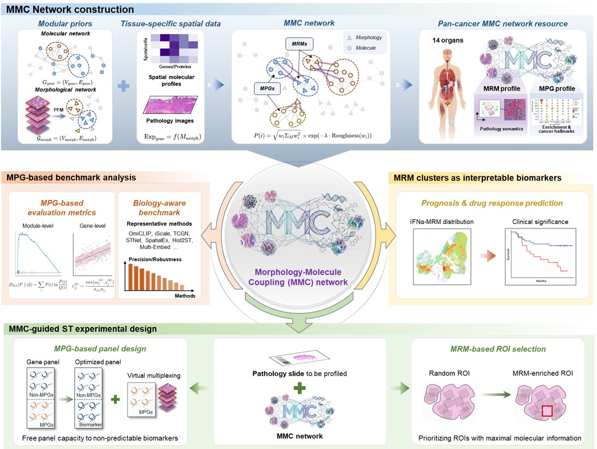

# MMC network

Morphology–molecule coupling (MMC) learns a pan-cancer map from pathology images to spatial molecular profiles.



The figure summarizes the method. A morphology prior and a gene prior are coupled on tissue-specific spatial data, and the network is read out as MPG and MRM profiles.

These scripts cover construction from the prior networks through module definition. More code and results will be released soon.

<!-- Paths in the scripts are placeholders. Replace them with local data paths before running.

## Scripts

Run these from the repository root, one organ at a time. The commands below use Breast / BRCA.

| Step | Script | What it does |
|---|---|---|
| 01 | `scripts/01_build_morphology_prior.py` | Build the morphology prior from UNI features |
| 02 | `scripts/02_build_ppi_network.py` | Build the gene prior from STRING |
| 03 | `scripts/03_train_mmc_w.py` | Learn the morphology-to-gene coupling matrix W |
| 03 | `scripts/03_score_mmc.py` | Score genes with the learned W |
| 04 | `scripts/04_call_mpg.py` | Call morphology-predictable genes |
| 05 | `scripts/05_call_mrm.py` | Compute MRMs from the significant MPGs |
| 06 | `scripts/06_define_modules.py` | Spectrally cluster modules and assign pathways |

```bash
python scripts/01_build_morphology_prior.py --prefix Breast --disease BRCA
python scripts/02_build_ppi_network.py --prefix Breast
python scripts/03_train_mmc_w.py --prefix Breast --dataset hest1k --n_perms 100
python scripts/03_score_mmc.py --prefix Breast --dataset hest1k --n_perms 100
python scripts/04_call_mpg.py --prefix Breast --dataset hest1k --n_perms 100 --quantile 1.0 --col_name gene_score
python scripts/05_call_mrm.py --prefix Breast --dataset hest1k --weight_mode uniform --agg_mode abs_sum --permutation --n_perms 100
python scripts/06_define_modules.py --prefix Breast --dataset hest1k
```

Step 02 needs the STRING identifier map for that organ and the human protein-link table. -->
